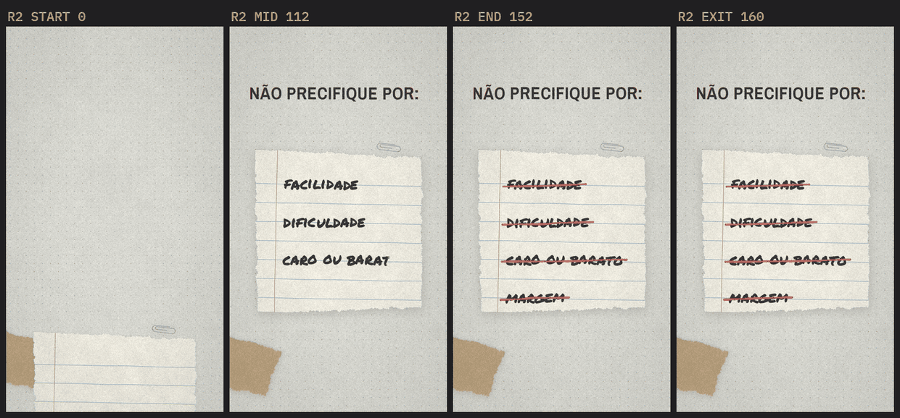
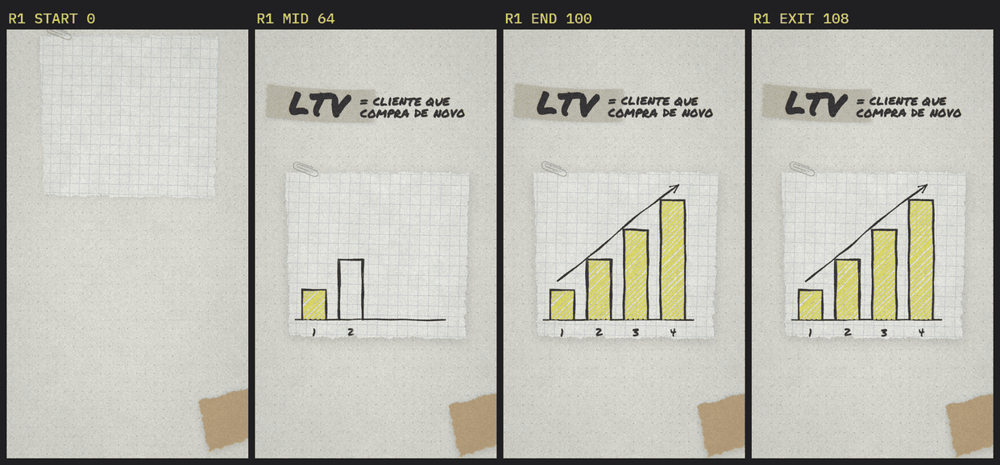
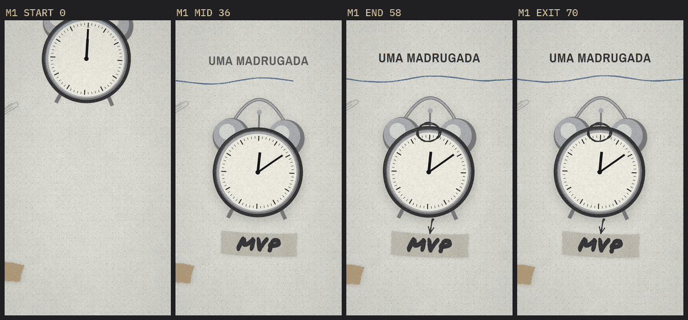
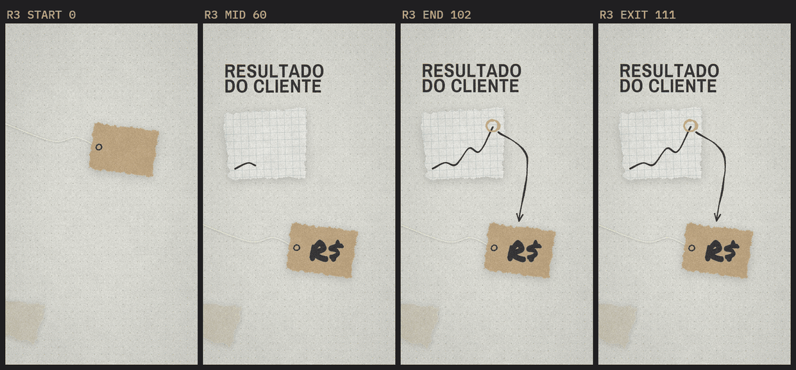
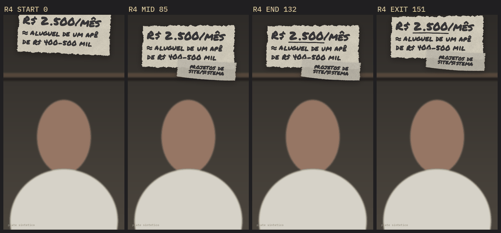
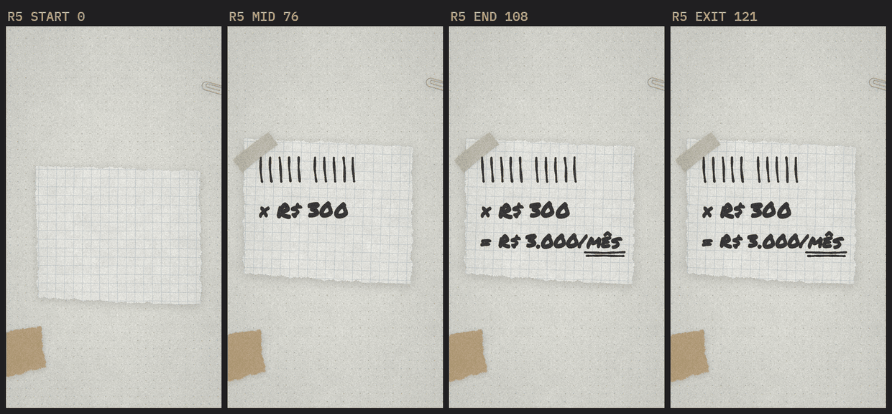

# Receitas do kit

Peças de cena que já foram escritas à mão numa run, custaram remontagem, e viraram
função em `lib/kit.py`. Antes de desenhar uma cena, procure aqui: a receita já tem a
ordem da mão, a âncora certa e a medida pela tinta — o que a run levou horas para
acertar.

Cada receita tem uma **cena-exemplo pronta** em `lib/compose_template.py` (que vira o
`compose.py` de todo projeto) e a folha com os 4 estados em `exemplo/receitas/`.
Para regerar a galeria num projeto limpo (é também o teste de instalação limpa):

```bash
./topclip py .claude/skills/topclip-motion/exemplo/gerar_receitas.py
```

| Receita | Funções | Registro | Exemplo |
| --- | --- | --- | --- |
| Papel no tamanho de uso | `scrap`, `fita`, `Papel` | todos (matéria) | R1, R2, R5 |
| Barras em hachura | `hatch_bar` | Dado a mão | R1 |
| Item riscado | `ink_bbox`, `strike_ink` | Anotação de campo | R2 |
| Fita-etiqueta | `tape_label` | Mesa de pesquisa, Anotação de campo | M1, R1, R4 |
| Etiqueta de preço com barbante | `price_tag` | Processo | R3 |
| Tira de papel no topo | `bilhete`, `nota_topo` | Anotação de campo (overlay) | R4 |
| Conta montada à mão | `hand_tally`, `conta`, `ink_span`, `sublinhado_duplo` | Dado a mão | R5 |

Utilitários que as receitas usam e servem a qualquer cena: `voo` (herói já em voo no
frame 0), `sombra_pouso` (sombra crescendo enquanto o papel desce), `lin` (progresso
linear), `hand_stroke` (traço solto de caneta), `hand_approx` (o "≈" desenhado),
`ink_span` (a tinta de um pedaço do texto), `sem_boil` (medir sem o boil deslocar a
borda).

---

## 1. Papel no tamanho de uso — `scrap()`, `fita()`



**Registro:** todos — é a matéria da mesa.

```python
folha = scrap("pautado", 788, 752, seed=111, rotation=-1.0)   # Papel
place(c, folha.im, pos, shadow=sombra_pouso(prog), kind="paper")
x, y = folha.ponto(folha.margem + 34, folha.linhas[0])          # escrever na pauta
```

Tipos: `kraft`, `pautado`, `quadriculado`, `cartao`, `folha`. `w`×`h` é o papel, sem
o respiro transparente. O pautado e o quadriculado saem em **escala de caderno real
para o quadro**: pauta de 92px (cabe uma linha de marcador de ~72px), grade de 44px —
não proporcionais ao tamanho do retalho. `fita(comprimento)` é a tira de crepe na
mesma lógica, na proporção da peça 0 do `A03_TAPE`.

**O que resolve.** As peças do `A10_SCRAPS` têm ~360px; ampliadas a ~800px borram a
fibra e a borda rasgada, que são a matéria do estilo, e engrossam a pauta junto. A run
do clip-010 escreveu um `gerar_assets.py` só para isso. `piece()` agora avisa quando
amplia uma peça mais de 1,25×.

`Papel.linhas`, `Papel.margem` estão em px do bitmap **sem rotação**; `Papel.ponto(x,
y)` leva para o bitmap girado (armadilha 1). O bitmap fica em cache no projeto
(`07_assets/cutout/_uso/`), com o hash de `desenho.py` no nome.

## 2. Barras em hachura — `hatch_bar()`



**Registro:** Dado a mão. Número que o falante estima não ganha gráfico limpo.

```python
c.alpha_composite(hatch_bar(c.size, x0, y0, x1, y1, d(frame, a, b), seed=100))
```

A ordem é a da mão: contorno em **duas passadas** (sobe pela esquerda, cruza o topo,
desce pela direita) nos primeiros 45%, depois a hachura de marcador amarela, traço a
traço, recortada na caixa. Rótulo embaixo em marcador: **"1", "2" — nunca "1ª"**, o
Permanent Marker desenha o ª como um A.

## 3. Item riscado — `ink_bbox()` + `strike_ink()`

**Registro:** Anotação de campo ("nada disso").

```python
kw = dict(anchor="lb", stroke_w=1, tracking=1, hand=True, seed=60)
c.alpha_composite(text_layer(c.size, "margem", F_MARKER, 72, xy, mode="write", progress=pr, **kw))
c.alpha_composite(strike_ink(c.size, ink_bbox("margem", F_MARKER, 72, xy, **kw), d(frame, a, b)))
```

O risco cruza o meio da **tinta** da palavra, medida sem boil (`ink_bbox`), uma
passada vermelha levemente inclinada. Medido pela caixa da fonte, o risco passava
acima das palavras (laudo D2 do clip-010). Passe a `ink_bbox` exatamente os mesmos
argumentos de desenho do `text_layer`.

## 4. Fita-etiqueta — `tape_label()`



**Registro:** Mesa de pesquisa, Anotação de campo.

```python
caixa = tape_label(c, "MVP", 118, cx, cy, tape=p(frame, a, b), write=d(frame, b, e),
                   rotation=-2.2, seed=21)
```

A fita é dimensionada **pela palavra** (largura = texto medido no desenho / 0,64) e
a palavra vai no **centro óptico** da fita (armadilhas 10–12). Aceita duas linhas
(`"projetos de\nsite/sistema"`): a fita cresce em altura. Fita e palavra são montadas
juntas sem boil, giram juntas e recebem **um** campo de boil — com campos separados a
etiqueta descola do papel (armadilha 34). Desenha em `c`, que pode ser o quadro ou um
grupo local (o bilhete da receita 6). Devolve a caixa da etiqueta, para a seta chegar
nela.

## 5. Etiqueta de preço com barbante — `price_tag()`



**Registro:** Processo — o preço é o **destino** da seta ("o preço sai do que você
gera para o cliente").

```python
tag = price_tag(c, 660, 1270, pouso=p(frame, 0, 10), write=d(frame, 12, 26), text="R$")
c.alpha_composite(hand_arrow(c.size, [origem, meio, (tag["topo"][0], tag["topo"][1] + 6)], ...))
```

Kraft no tamanho de uso, furo com aro desenhado, barbante cor de linha saindo do furo
e escapando pela borda esquerda, com sombra própria. Já em voo no frame 0: cai com
overshoot. Furo e barbante andam com a etiqueta (medidos com `Papel.ponto`). Devolve
`pos`, `size`, `furo`, `centro`, `topo`.

## 6. Tira de papel no topo — `bilhete()` + `nota_topo()`



**Registro:** Anotação de campo, em **overlay** — a escala ou o lembrete na tela desde
o frame 0, sobre o cenário, com o rosto livre (clip-005: "R$ 2.500/mês ≈ aluguel").

```python
def build_O1(frame, overlay_only=True):
    boil_ctx(frame)
    g, papel, origem = bilhete(830, 372, seed=104)        # canvas local 1080x660
    g.alpha_composite(text_layer(g.size, "≈ aluguel de um apê", F_MARKER, 62, (170, 258), ...))
    tape_label(g, "projetos de\nsite/sistema", 50, 706, 500, tape=p(frame, 77, 85), ...)
    return nota_topo(g, pouso=p(frame, -6, 9), assenta=p(frame, 9, 146),
                     saida=ease_in(lin(frame, 147, 157)), frame=frame)
```

O bilhete inteiro é **um objeto**: monta no canvas local e gira junto. `nota_topo` dá
o movimento — cai já em voo, **assenta devagar** (8px e 0,6° em vários segundos; parado
3s ele morre em cena) e sai subindo levando a fita junto — e a sombra `SH_ONVID`, que
crava no vídeo. Grão leve só na matéria; o plate não é tocado.

O estado do overlay é julgado **sobre o vídeo**: com `<CENA>_T0` no compose, o plate de
cada estado sai sozinho do `00_brief/fonte.mp4` para `09_plates/`. Confira no plate que
nada desce até o topo da cabeça.

Dois detalhes que a run pegou no laudo: no marcador o ponto de "2.500" encosta no pé do
"2" e some — escreva em duas emendas (`"R$ 2"` + `".500/mês"`); e o "≈" não existe na
fonte — o `text_layer` desenha o sinal à caneta sozinho.

## 7. Conta montada à mão — `hand_tally()` + `conta()` + `sublinhado_duplo()`



**Registro:** Dado a mão.

```python
c.alpha_composite(hand_tally(c.size, 168, 668, 10, lin(frame, 14, 36)))   # "10 projetos"
caixas = conta(c, [("× R$ 300", 96), ("= R$ 3.000/mês", 86)], 168, 850,
               [d(frame, 62, 74), d(frame, 80, 98)], passo=160)
x0, _, x1, _ = ink_span("= R$ 3.000/mês", "mês", F_MARKER, 86, (168, 1010), anchor="lt",
                        stroke_w=3, tracking=2, hand=True, seed=71)
c.alpha_composite(sublinhado_duplo(c.size, x0, x1, caixas[1][3] + 14, p1, p2))
```

Cada item entra **na sua palavra**: os tracinhos um depois do outro entre "10" e
"projetos", a multiplicação no "300", o resultado no "3 mil", o sublinhado duplo no
"mês". Coluna alinhada à esquerda, como conta de papel. `ink_span` mede só o pedaço
do texto, desenhado exatamente como o texto inteiro — sublinhar pela fonte erra a
posição em até 20% no modo `hand`.

---

## Glifos que a fonte não tem

`text_layer` avisa (uma vez, no stderr) todo caractere que a fonte **não tem** ou
**desenha errado** — o PIL não acusa nada. No Permanent Marker, medido:

| Caractere | Sai como | O que fazer |
| --- | --- | --- |
| `≈` | um traço vertical (o desenho de um "i") | nada: o `text_layer` desenha o sinal à caneta no lugar (`hand_approx`) |
| `ª`, `º` | "A", "O" — "1ª" lê "1A" | escreva só o número |
| `→ ≠ ≤ ≥ ✓` | nada (glifo vazio) | desenhe: seta é `hand_arrow` |

## O fluxo rápido

- `./topclip py compose.py` renderiza os estados **em paralelo** e monta
  `<cena>_ESTADOS.png` — os 4 lado a lado a 360px. Revise essa folha em vez de abrir
  quatro imagens.
- `./topclip py render.py --rascunho` monta com x264 `veryfast` em `RASCUNHO.mp4`
  (quadros em paralelo, legenda conferida antes de tudo). Uma cena só:
  `render.py M2 --rascunho`. O master final (`slow`) sai **uma vez**, no fim.
- A montagem confere sozinha duração, cadência, quadros e MD5 do áudio contra a fonte
  (laudo D5).
