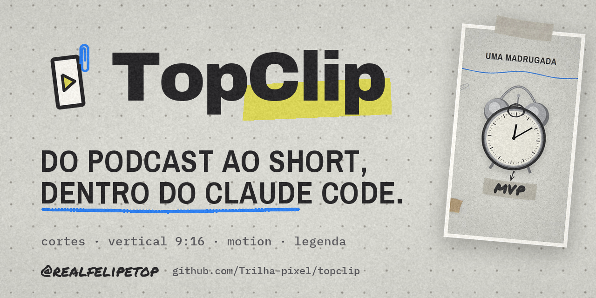
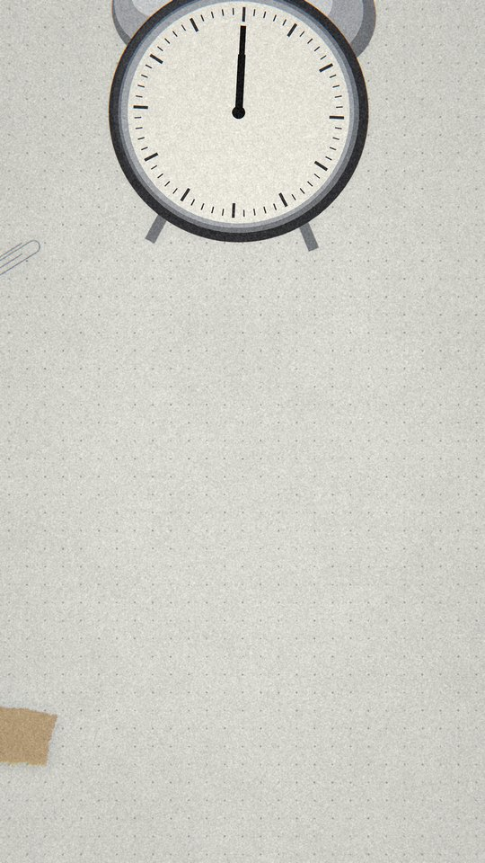
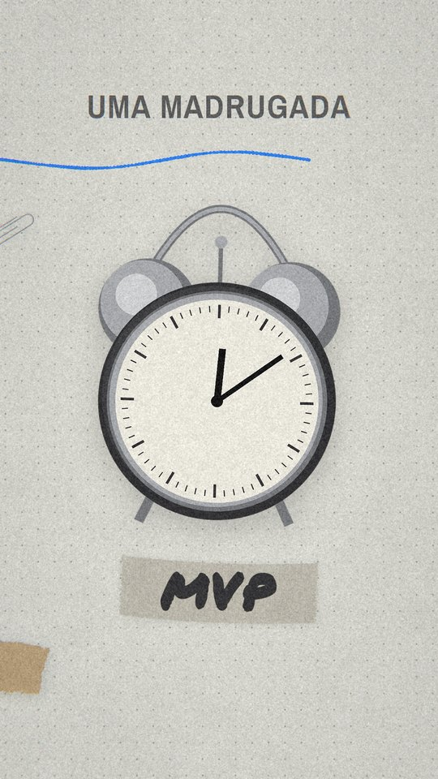
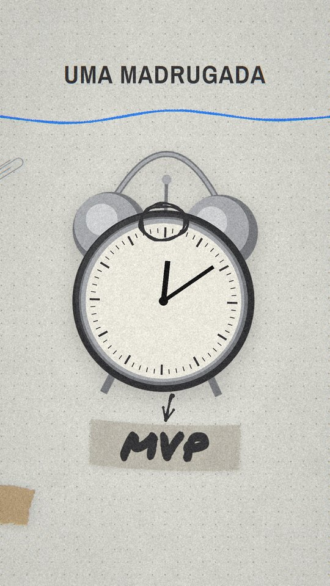
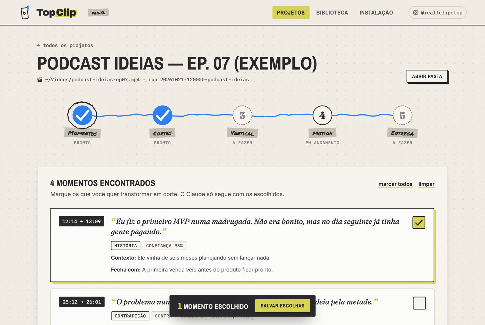

<p align="center">
  
</p>

# TopClip ✂️

**Do podcast de 2 horas ao Short pronto — dentro do Claude Code.**

Você entrega um vídeo longo. O TopClip acha os momentos que funcionam fora de contexto,
corta no ponto exato, enquadra em 9:16 seguindo quem está falando e coloca motion
editorial com legenda queimada. Tudo rodando no seu computador, comandado pelo Claude.

<p align="center">
  
  
  
</p>

<p align="center"><sub>Uma cena de motion do TopClip — cada objeto foi desenhado em código pelo Claude.</sub></p>

## O que ele faz

| | |
| --- | --- |
| 🎯 **Acha os cortes** | Lê a transcrição inteira e encontra os trechos com gancho, desenvolvimento e fechamento — os que prendem quem cai ali sem contexto. |
| ✂️ **Corta no ponto certo** | In/out cravado no timing de cada palavra. Nada de frase cortada no meio ou começando em "então". |
| 📱 **Deixa vertical** | Enquadramento 9:16 que segue **quem está falando** (movimento da boca cruzado com o áudio), não o maior rosto. |
| 🎨 **Coloca motion** | Cenas no estilo **TopClip Papel** — papel marfim, fita crepe, anotação à mão — ancoradas na palavra exata da fala. |
| 💬 **Legenda queimada** | Palavra a palavra, sincronizada, com destaque só onde importa. |
| 🧠 **100% Claude** | Os assets do motion são desenhados em código pelo próprio Claude. Sem gerador de imagem pago, sem API extra. |
| 🖥️ **Painel no navegador** | Escolha momentos e cortes clicando, assista as prévias e acompanhe cada projeto — sem precisar entender de código. |

## Instalação

Precisa de **macOS** ou **Linux** (no Windows, use o [WSL](https://learn.microsoft.com/windows/wsl/install)) e do
[Claude Code](https://claude.com/claude-code).

```bash
git clone https://github.com/Trilha-pixel/topclip.git
cd topclip
./topclip instalar
```

O instalador coloca o `ffmpeg` e o Python 3.11 (Homebrew no Mac, apt no Linux), cria o
ambiente em `.venv/`, baixa o modelo de detecção de rosto e roda a verificação no fim.

## Como usar

Abra o Claude Code **dentro da pasta `topclip`** e peça:

```text
corta esse podcast: ~/Videos/meu-podcast.mp4
```

O vídeo não precisa estar no computador — um link do YouTube ou do Instagram serve:

```text
corta esse podcast: https://www.youtube.com/watch?v=...
```

O TopClip baixa o vídeo (até 1080p) para `projetos/` e, no YouTube, aproveita a
legenda automática com o tempo de cada palavra, o que pula a transcrição.

Ou chame direto:

| Comando | O que faz |
| --- | --- |
| `/topclip video.mp4` | o fluxo inteiro: cortes → vertical → motion → entrega |
| `/topclip-corte video.mp4` | só os cortes verticais, sem motion |
| `/topclip-motion` | só o motion e a legenda, num clipe vertical que já existe |

Em cada etapa o Claude **para e mostra o resultado** antes de seguir: primeiro a lista
de momentos, cada um com uma nota estimada, depois os cortes para você assistir,
depois o vertical, depois o motion. Você escolhe o que sobrevive — e escolher poucos
momentos (de 2 a 5) é o que mais deixa o resto rápido.

Tudo que você produz fica em `projetos/`, que nunca vai para o git.

## O painel

Para quem prefere clicar a digitar, o TopClip tem um painel que roda no seu computador:

```bash
./topclip painel
```

Ele abre no navegador (`http://127.0.0.1:7777`) e mostra seus projetos, os momentos que
o Claude encontrou (em ordem de nota), as prévias dos cortes e os clipes prontos. Você **marca o que quer**
ali mesmo e volta ao Claude dizendo *"escolhi no painel, pode seguir"*. Ainda não tem
projeto? Clique em **Ver um exemplo**.

Para começar um projeto, clique em **Novo projeto** e escolha o vídeo pelo Finder — ou
simplesmente arraste o arquivo para o painel. Nada é copiado nem enviado: o painel só
anota onde o vídeo está. Também dá para **colar o link** de um vídeo do YouTube ou do
Instagram: o painel mostra o título para você conferir e baixa o vídeo para dentro do
projeto, com o andamento ao vivo.

<p align="center">
  
</p>

O painel só existe no seu computador: escuta apenas em `127.0.0.1` e não aparece na rede.

## Como funciona

```text
vídeo longo
   │
   ▼  topclip-corte
   ├─ 1. MOMENTOS   transcrição palavra a palavra → os trechos que dariam corte
   ├─ 2. CORTES     in/out exato, revisão cega, sem clipe duplicado
   ├─ 3. VERTICAL   9:16 seguindo o locutor ativo
   └─ 4. ENTREGA    clipe limpo + timing por palavra
   │
   ▼  topclip-motion
   ├─ assets da biblioteca ou desenhados na hora
   ├─ cenas em camadas, cada evento preso a uma palavra
   ├─ legenda queimada
   └─ master final, com o áudio original intacto (MD5 conferido)
```

A seleção dos cortes roda inteira sobre a **transcrição** — o vídeo só é aberto
depois que já se sabe onde cortar. É isso que deixa possível processar um podcast de
3 horas sem estourar o contexto do Claude.

## Biblioteca de assets

Todo objeto desenhado num vídeo volta para `biblioteca/assets/` e fica pronto para o
próximo. Quanto mais o TopClip é usado, mais coisa já vem pronta.
Quer contribuir? Desenhe um objeto novo em `.claude/skills/topclip-motion/lib/desenho.py` e abra um PR — veja
[biblioteca/MANIFESTO.md](biblioteca/MANIFESTO.md).

Prefere objetos com cara de foto? O motion aceita imagens de qualquer gerador
(Google Flow, Gemini, Higgsfield…): gere, solte o PNG na pasta do projeto e o
TopClip recorta e compõe.

## O que é bom saber

- **O Claude Code exige um plano pago** (Pro ou Max) ou chave de API. O TopClip em si
  é gratuito; o pipeline usa bastante contexto, então vídeos muito longos consomem mais.
- **A primeira transcrição baixa os modelos**: ~0,5 GB para os cortes e ~1,6 GB para o
  motion. Depois ficam em cache. Em Mac com chip M1 ou mais novo, a transcrição dos
  cortes roda na placa de vídeo, 2 a 2,5x mais rápida, e o painel mostra o avanço.
- **Ninguém garante viral.** O TopClip estima o que tem potencial; o resultado real só
  a plataforma diz.
- **Corte só o que você tem direito de usar.** Conteúdo de terceiros exige autorização.

## Comandos úteis

```bash
./topclip painel         # abre o painel no navegador
./topclip verificar      # confere se está tudo pronto
./topclip testes         # roda a suíte de testes
./topclip ajuda          # lista todos os comandos
```

## Estrutura

```text
topclip/
├── topclip                  o lançador — todo comando passa por ele
├── instalar.sh
├── .claude/
│   ├── skills/
│   │   ├── topclip/         o fluxo completo
│   │   ├── topclip-corte/   cortes e vertical
│   │   └── topclip-motion/  motion e legenda
│   └── agents/              os 8 subagentes do pipeline de cortes
├── painel/                  o painel local (Python puro + uma página web)
├── biblioteca/              assets reaproveitados entre vídeos
└── projetos/                seus vídeos e resultados (fora do git)
```

## Quem fez

Criado por **Felipe Top**. Tutoriais, bastidores e novidades do TopClip no Instagram:
[@realfelipetop](https://www.instagram.com/realfelipetop/).

## Licença

Código sob [MIT](LICENSE). As fontes em `.claude/skills/topclip-motion/fontes/` são de
licença livre (OFL / Apache 2.0) e trazem os próprios arquivos de licença. O modelo
YuNet de detecção de rosto vem do [OpenCV Zoo](https://github.com/opencv/opencv_zoo) (MIT).
